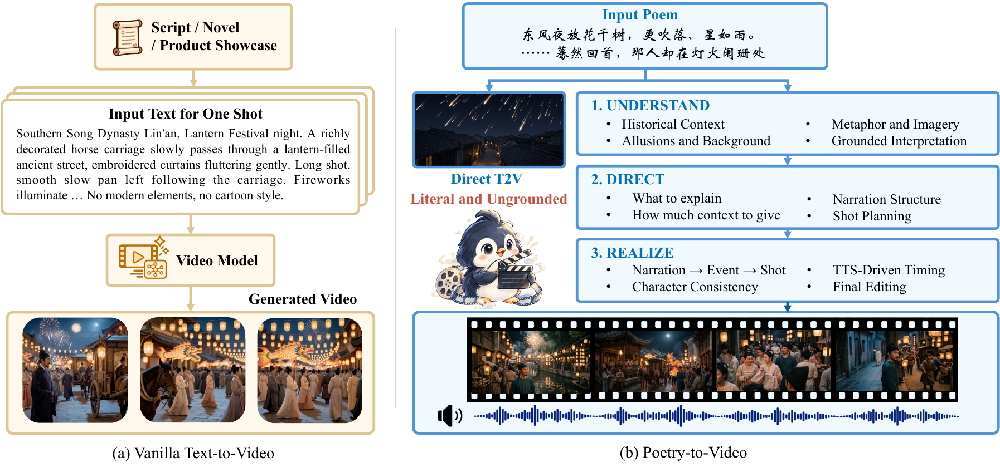
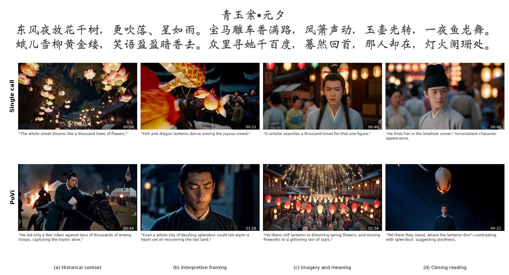

# PoVi

**PoVi: Agentic Poetry-to-Video Generation with Knowledge Grounding and Figurative Understanding**

<p align="center">
  <a href="https://openraiser.github.io/PoVi/"></a>
  <a href="https://github.com/OpenRaiser/PoVi"></a>
  <a href="https://huggingface.co/datasets/Fortunaa/PoVi"></a>
  
</p>

Poetry-to-video needs more than literal scene rendering: compressed language, background knowledge, and metaphor. PoVi is a **benchmark** (PoVi-Bench) and an **agentic generation framework** that rebuilds poem semantics into an evidence-bounded Director Graph, then realizes narration, close reading, character assets, and shot plans before narration-aligned video synthesis.

| | |
| --- | --- |
| Benchmark | [`Benchmark/`](Benchmark/) — PoVi-Bench metrics S1–S6 / D1–D4 / R1–R7 |
| Generation | [`VGen/`](VGen/) — Director Graph → five agents → media backends |

## Overview



## Method

Director Graph (knowledge inventory + graph generation) → context story / story narration / close reading / character assets / visual direction → image / TTS / video.


## PoVi-Bench

120 works (60 Tang poetry + 60 Song ci), balanced Easy / Medium / Challenging.

| Literary form | Easy | Medium | Challenging | Total |
| --- | ---: | ---: | ---: | ---: |
| Tang poetry | 20 | 20 | 20 | 60 |
| Song ci | 20 | 20 | 20 | 60 |
| **Total** | **40** | **40** | **40** | **120** |

<table>
  <tr>
    <td width="50%" align="center">
      
      <br/><sub>Audio-clocked assembly</sub>
    </td>
    <td width="50%" align="center">
      
      <br/><sub>PoVi-Bench metric overview</sub>
    </td>
  </tr>
</table>

## Results (paper, human ratings)

Scores in [0, 1]. D1/D2/R3/R5 are 1–5 ratings divided by 5. **ours** = PoVi agentic pipeline; **single call** = one-shot baseline.

### Narration (S/D)

| Backbone | System | S1 | S2 | S3 | S4 | S5 | S6 | D1 | D2 |
| --- | --- | ---: | ---: | ---: | ---: | ---: | ---: | ---: | ---: |
| Gemini-3.5-Flash | single call | 0.611 | 0.931 | 0.851 | 0.617 | 0.889 | 0.943 | 0.815 | 0.633 |
| Gemini-3.5-Flash | **ours** | **0.814** | **0.951** | **0.915** | **0.789** | **0.943** | **0.965** | **0.952** | **0.800** |
| DeepSeek-V4-Flash | single call | 0.533 | 0.756 | 0.512 | 0.334 | 0.688 | 0.955 | 0.725 | 0.825 |
| DeepSeek-V4-Flash | **ours** | **0.706** | **0.894** | **0.775** | **0.521** | **0.954** | **0.957** | **0.897** | 0.569 |
| Seed-2.0-Lite | single call | 0.625 | 0.478 | 0.400 | 0.365 | 0.665 | 0.944 | 0.906 | 0.334 |
| Seed-2.0-Lite | **ours** | **0.859** | **0.692** | **0.701** | **0.428** | **0.907** | **0.961** | **0.952** | **0.688** |

### Video (R), Gemini planner

| Generator | System | R1 | R2 | R3 | R4 | R5 |
| --- | --- | ---: | ---: | ---: | ---: | ---: |
| MiniMax-H3 | single call | 0.870 | 0.910 | 0.866 | 0.950 | 0.882 |
| MiniMax-H3 | **ours** | **0.930** | **0.930** | **0.918** | **0.950** | **0.912** |
| Wan2.2-VACE | single call | 0.671 | 0.788 | 0.698 | 0.900 | 0.734 |
| Wan2.2-VACE | **ours** | **0.832** | **0.876** | **0.898** | **0.900** | **0.824** |
| Veo-3.1 | single call | 0.699 | 0.980 | 0.897 | 0.950 | 0.811 |
| Veo-3.1 | **ours** | **0.754** | **0.998** | **0.944** | **0.984** | **0.844** |
| Seedance-2.0 | single call | 0.770 | 0.958 | 0.939 | 0.880 | 0.896 |
| Seedance-2.0 | **ours** | **0.862** | **0.978** | **0.984** | **0.978** | **0.903** |

### vs. other agentic pipelines (DeepSeek-V4-Flash planner)

| System | S1 | S4 | S5 | D2 | R1 | R3 |
| --- | ---: | ---: | ---: | ---: | ---: | ---: |
| ArcReel | 0.780 | 0.900 | 0.800 | 0.640 | 0.800 | 0.920 |
| Lumenx | 0.700 | 0.680 | 0.960 | 0.680 | 0.780 | 0.880 |
| **ours** | **0.880** | **0.930** | **0.970** | **0.880** | **0.880** | **0.960** |

## Qualitative example

Xin Qiji, *Qingyu An: Lantern Festival*. Layout follows the paper case study: poem banner + Single call vs PoVi (4 frames each), Gemini-3.5-Flash + MiniMax-H3.



## Code

```bash
# evaluate
cd Benchmark && # see Benchmark/README.md

# generate (same method as paper media runs)
cd VGen
# LLM_MODEL=gemini-3.5-flash + scripts/run_director_graph_minimax_h3.sh
# see VGen/README.md
```

Figures in `docs/figures/` come from the paper PDFs in `ARR_PoVi.zip`. The qualitative panel is composed like `acl_latex.tex` Fig. case study (banner + `base_*` / `povi_*` frames), not the thin `qingyuan.pdf` strip alone.

## Citation

```bibtex
@article{povi2026,
  title   = {PoVi: Agentic Poetry-to-Video Generation with Knowledge Grounding and Figurative Understanding},
  author  = {Anonymous},
  journal = {Under review},
  year    = {2026}
}
```
