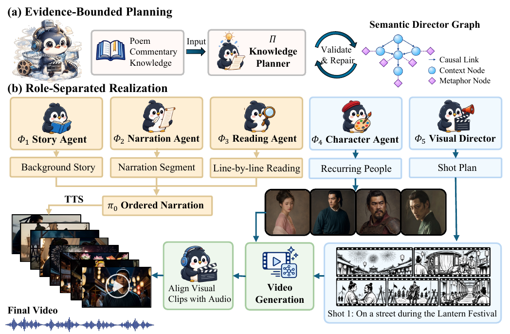
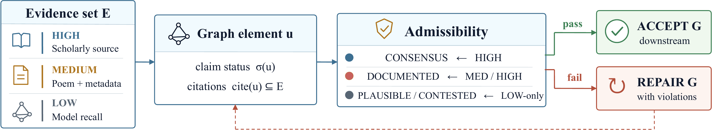
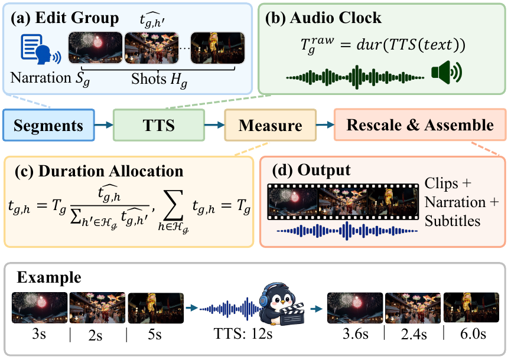
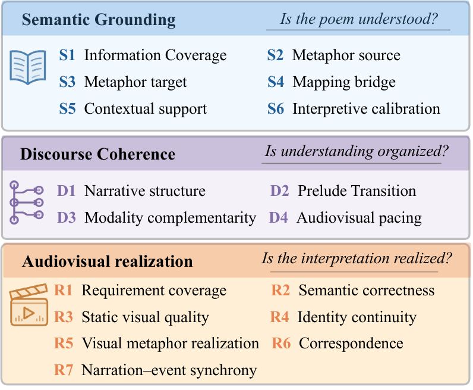

# PoVi

**PoVi: Agentic Poetry-to-Video Generation with Knowledge Grounding and Figurative Understanding**

<p align="center">
  <a href="https://openraiser.github.io/PoVi/"></a>
  <a href="https://github.com/OpenRaiser/PoVi"></a>
  <a href="https://huggingface.co/datasets/Fortunaa/PoVi"></a>
  
</p>

Poetry-to-video needs more than literal scene rendering: compressed language, background knowledge, and metaphor. PoVi is a **benchmark** (PoVi-Bench) and an **agentic generation framework** that rebuilds poem semantics into an evidence-bounded Director Graph, then realizes narration, close reading, character assets, and shot plans before narration-aligned video synthesis.

| | |
| --- | --- |
| Benchmark | [`Benchmark/`](Benchmark/) — PoVi-Bench metrics S1–S6 / D1–D4 / R1–R7 |
| Generation | [`VGen/`](VGen/) — Director Graph → five agents → media backends |

## Overview


## Method

Director Graph (knowledge inventory + graph generation) → context story / story narration / close reading / character assets / visual direction → image / TTS / video.





## PoVi-Bench

120 works (60 Tang poetry + 60 Song ci), balanced Easy / Medium / Challenging.

| Literary form | Easy | Medium | Challenging | Total |
| --- | ---: | ---: | ---: | ---: |
| Tang poetry | 20 | 20 | 20 | 60 |
| Song ci | 20 | 20 | 20 | 60 |
| **Total** | **40** | **40** | **40** | **120** |

<table>
  <tr>
    <td width="50%" align="center">
      
      <br/><sub>Audio-clocked assembly</sub>
    </td>
    <td width="50%" align="center">
      
      <br/><sub>PoVi-Bench metric overview</sub>
    </td>
  </tr>
</table>

## Results (paper, human ratings)

Scores in [0, 1]. D1/D2/R3/R5 are 1–5 ratings divided by 5. **ours** = PoVi agentic pipeline; **single call** = one-shot baseline.

### Narration (S/D)

| Backbone | System | S1 | S2 | S3 | S4 | S5 | S6 | D1 | D2 |
| --- | --- | ---: | ---: | ---: | ---: | ---: | ---: | ---: | ---: |
| Gemini-3.5-Flash | single call | 0.611 | 0.931 | 0.851 | 0.617 | 0.889 | 0.943 | 0.815 | 0.633 |
| Gemini-3.5-Flash | **ours** | **0.814** | **0.951** | **0.915** | **0.789** | **0.943** | **0.965** | **0.952** | **0.800** |
| DeepSeek-V4-Flash | single call | 0.533 | 0.756 | 0.512 | 0.334 | 0.688 | 0.955 | 0.725 | 0.825 |
| DeepSeek-V4-Flash | **ours** | **0.706** | **0.894** | **0.775** | **0.521** | **0.954** | **0.957** | **0.897** | 0.569 |
| Seed-2.0-Lite | single call | 0.625 | 0.478 | 0.400 | 0.365 | 0.665 | 0.944 | 0.906 | 0.334 |
| Seed-2.0-Lite | **ours** | **0.859** | **0.692** | **0.701** | **0.428** | **0.907** | **0.961** | **0.952** | **0.688** |

### Video (R), Gemini planner

| Generator | System | R1 | R2 | R3 | R4 | R5 |
| --- | --- | ---: | ---: | ---: | ---: | ---: |
| MiniMax-H3 | single call | 0.870 | 0.910 | 0.866 | 0.950 | 0.882 |
| MiniMax-H3 | **ours** | **0.930** | **0.930** | **0.918** | **0.950** | **0.912** |
| Wan2.2-VACE | single call | 0.671 | 0.788 | 0.698 | 0.900 | 0.734 |
| Wan2.2-VACE | **ours** | **0.832** | **0.876** | **0.898** | **0.900** | **0.824** |
| Veo-3.1 | single call | 0.699 | 0.980 | 0.897 | 0.950 | 0.811 |
| Veo-3.1 | **ours** | **0.754** | **0.998** | **0.944** | **0.984** | **0.844** |
| Seedance-2.0 | single call | 0.770 | 0.958 | 0.939 | 0.880 | 0.896 |
| Seedance-2.0 | **ours** | **0.862** | **0.978** | **0.984** | **0.978** | **0.903** |

### vs. other agentic pipelines (DeepSeek-V4-Flash planner)

| System | S1 | S4 | S5 | D2 | R1 | R3 |
| --- | ---: | ---: | ---: | ---: | ---: | ---: |
| ArcReel | 0.780 | 0.900 | 0.800 | 0.640 | 0.800 | 0.920 |
| Lumenx | 0.700 | 0.680 | 0.960 | 0.680 | 0.780 | 0.880 |
| **ours** | **0.880** | **0.930** | **0.970** | **0.880** | **0.880** | **0.960** |

## Qualitative example

Xin Qiji, *Qingyu An: Lantern Festival*. Layout follows the paper case study: poem banner + Single call vs PoVi (4 frames each), Gemini-3.5-Flash + MiniMax-H3.


## Showcase

39 films generated by PoVi — 20 Tang poems and 19 Song ci, 3 h 21 min in total. Each is a complete narrated teaching film: background story, line-by-line close reading, recurring characters, and shots cut to the measured narration.

Every still is a frame from the film below it; click to play. The [project page](https://openraiser.github.io/PoVi/) serves the same films with an interactive selector and all nine frames per work.

### Tang poetry

<table>
<tr>
<td width="33%" align="center" valign="top">
<a href="https://openraiser.github.io/PoVi/assets/videos/fengqiao.mp4"></a>
<br>
<b>Mooring by Maple Bridge</b> · <span lang="zh-Hans">枫桥夜泊</span>
<br>
<sub>Zhang Ji · Tang poetry · Introductory · 4:14</sub>
</td>
<td width="33%" align="center" valign="top">
<a href="https://openraiser.github.io/PoVi/assets/videos/furong.mp4"></a>
<br>
<b>At Hibiscus Tower, Seeing Off Xin Jian</b> · <span lang="zh-Hans">芙蓉楼送辛渐</span>
<br>
<sub>Wang Changling · Tang poetry · Introductory · 4:35</sub>
</td>
<td width="33%" align="center" valign="top">
<a href="https://openraiser.github.io/PoVi/assets/videos/jingyesi.mp4"></a>
<br>
<b>Quiet Night Thoughts</b> · <span lang="zh-Hans">静夜思</span>
<br>
<sub>Li Bai · Tang poetry · Introductory · 4:11</sub>
</td>
</tr>
<tr>
<td width="33%" align="center" valign="top">
<a href="https://openraiser.github.io/PoVi/assets/videos/huanghelou.mp4"></a>
<br>
<b>Seeing Meng Haoran Off at Yellow Crane Tower</b> · <span lang="zh-Hans">黄鹤楼送孟浩然之广陵</span>
<br>
<sub>Li Bai · Tang poetry · Introductory · 4:07</sub>
</td>
<td width="33%" align="center" valign="top">
<a href="https://openraiser.github.io/PoVi/assets/videos/huixiang.mp4"></a>
<br>
<b>Occasional Lines on Returning Home · I</b> · <span lang="zh-Hans">回乡偶书</span>
<br>
<sub>He Zhizhang · Tang poetry · Introductory · 4:22</sub>
</td>
<td width="33%" align="center" valign="top">
<a href="https://openraiser.github.io/PoVi/assets/videos/xunyinzhe.mp4"></a>
<br>
<b>Seeking the Recluse and Not Meeting Him</b> · <span lang="zh-Hans">寻隐者不遇</span>
<br>
<sub>Jia Dao · Tang poetry · Introductory · 4:10</sub>
</td>
</tr>
<tr>
<td width="33%" align="center" valign="top">
<a href="https://openraiser.github.io/PoVi/assets/videos/jiangxue.mp4"></a>
<br>
<b>River Snow</b> · <span lang="zh-Hans">江雪</span>
<br>
<sub>Liu Zongyuan · Tang poetry · Introductory · 4:31</sub>
</td>
<td width="33%" align="center" valign="top">
<a href="https://openraiser.github.io/PoVi/assets/videos/chibi.mp4"></a>
<br>
<b>Red Cliff</b> · <span lang="zh-Hans">赤壁</span>
<br>
<sub>Du Mu · Tang poetry · Introductory · 4:42</sub>
</td>
<td width="33%" align="center" valign="top">
<a href="https://openraiser.github.io/PoVi/assets/videos/luzhai.mp4"></a>
<br>
<b>Deer Enclosure</b> · <span lang="zh-Hans">鹿柴</span>
<br>
<sub>Wang Wei · Tang poetry · Introductory · 4:34</sub>
</td>
</tr>
<tr>
<td width="33%" align="center" valign="top">
<a href="https://openraiser.github.io/PoVi/assets/videos/guanque.mp4"></a>
<br>
<b>On Stork Tower</b> · <span lang="zh-Hans">登鹳雀楼</span>
<br>
<sub>Wang Zhihuan · Tang poetry · Introductory · 4:10</sub>
</td>
<td width="33%" align="center" valign="top">
<a href="https://openraiser.github.io/PoVi/assets/videos/wangyue.mp4"></a>
<br>
<b>Looking at the Moon, Thinking of Far Away</b> · <span lang="zh-Hans">望月怀远</span>
<br>
<sub>Zhang Jiuling · Tang poetry · Intermediate · 3:58</sub>
</td>
<td width="33%" align="center" valign="top">
<a href="https://openraiser.github.io/PoVi/assets/videos/chusai.mp4"></a>
<br>
<b>On the Frontier</b> · <span lang="zh-Hans">出塞</span>
<br>
<sub>Wang Changling · Tang poetry · Intermediate · 4:27</sub>
</td>
</tr>
<tr>
<td width="33%" align="center" valign="top">
<a href="https://openraiser.github.io/PoVi/assets/videos/wuyixiang.mp4"></a>
<br>
<b>Wuyi Lane</b> · <span lang="zh-Hans">乌衣巷</span>
<br>
<sub>Liu Yuxi · Tang poetry · Intermediate · 4:15</sub>
</td>
<td width="33%" align="center" valign="top">
<a href="https://openraiser.github.io/PoVi/assets/videos/chunwang.mp4"></a>
<br>
<b>Spring View</b> · <span lang="zh-Hans">春望</span>
<br>
<sub>Du Fu · Tang poetry · Intermediate · 5:55</sub>
</td>
<td width="33%" align="center" valign="top">
<a href="https://openraiser.github.io/PoVi/assets/videos/shanju.mp4"></a>
<br>
<b>Autumn Evening in the Mountains</b> · <span lang="zh-Hans">山居秋暝</span>
<br>
<sub>Wang Wei · Tang poetry · Intermediate · 5:49</sub>
</td>
</tr>
<tr>
<td width="33%" align="center" valign="top">
<a href="https://openraiser.github.io/PoVi/assets/videos/denggao.mp4"></a>
<br>
<b>Climbing High</b> · <span lang="zh-Hans">登高</span>
<br>
<sub>Du Fu · Tang poetry · Intermediate · 4:20</sub>
</td>
<td width="33%" align="center" valign="top">
<a href="https://openraiser.github.io/PoVi/assets/videos/jinse.mp4"></a>
<br>
<b>Jinse</b> · <span lang="zh-Hans">锦瑟</span>
<br>
<sub>Li Shangyin · Tang poetry · Challenging · 4:42</sub>
</td>
<td width="33%" align="center" valign="top">
<a href="https://openraiser.github.io/PoVi/assets/videos/changxiangsi.mp4"></a>
<br>
<b>Chang Xiang Si · I</b> · <span lang="zh-Hans">长相思</span>
<br>
<sub>Li Bai · Tang poetry · Challenging · 5:33</sub>
</td>
</tr>
<tr>
<td width="33%" align="center" valign="top">
<a href="https://openraiser.github.io/PoVi/assets/videos/youzhou.mp4"></a>
<br>
<b>Song on Climbing Youzhou Terrace</b> · <span lang="zh-Hans">登幽州台歌</span>
<br>
<sub>Chen Zi’ang · Tang poetry · Challenging · 3:50</sub>
</td>
<td width="33%" align="center" valign="top">
<a href="https://openraiser.github.io/PoVi/assets/videos/baixuege.mp4"></a>
<br>
<b>Song of White Snow, Seeing Off Secretary Wu</b> · <span lang="zh-Hans">白雪歌送武判官归京</span>
<br>
<sub>Cen Shen · Tang poetry · Challenging · 8:46</sub>
</td>
<td width="33%"></td>
</tr>
</table>

### Song ci

<table>
<tr>
<td width="33%" align="center" valign="top">
<a href="https://openraiser.github.io/PoVi/assets/videos/yongmei.mp4"></a>
<br>
<b>Bu Suan Zi · Ode to the Plum</b> · <span lang="zh-Hans">卜算子·咏梅</span>
<br>
<sub>Lu You · Song ci · Introductory · 5:27</sub>
</td>
<td width="33%" align="center" valign="top">
<a href="https://openraiser.github.io/PoVi/assets/videos/huanxisha.mp4"></a>
<br>
<b>Huan Xi Sha</b> · <span lang="zh-Hans">浣溪沙</span>
<br>
<sub>Yan Shu · Song ci · Introductory · 4:56</sub>
</td>
<td width="33%" align="center" valign="top">
<a href="https://openraiser.github.io/PoVi/assets/videos/sumuzhe.mp4"></a>
<br>
<b>Su Mu Zhe</b> · <span lang="zh-Hans">苏幕遮</span>
<br>
<sub>Fan Zhongyan · Song ci · Intermediate · 5:45</sub>
</td>
</tr>
<tr>
<td width="33%" align="center" valign="top">
<a href="https://openraiser.github.io/PoVi/assets/videos/shuidiao.mp4"></a>
<br>
<b>Shui Diao Ge Tou</b> · <span lang="zh-Hans">水调歌头</span>
<br>
<sub>Su Shi · Song ci · Intermediate · 5:49</sub>
</td>
<td width="33%" align="center" valign="top">
<a href="https://openraiser.github.io/PoVi/assets/videos/dingfengbo.mp4"></a>
<br>
<b>Ding Feng Bo</b> · <span lang="zh-Hans">定风波</span>
<br>
<sub>Su Shi · Song ci · Intermediate · 4:47</sub>
</td>
<td width="33%" align="center" valign="top">
<a href="https://openraiser.github.io/PoVi/assets/videos/zuihuayin.mp4"></a>
<br>
<b>Zui Hua Yin</b> · <span lang="zh-Hans">醉花阴</span>
<br>
<sub>Li Qingzhao · Song ci · Intermediate · 5:29</sub>
</td>
</tr>
<tr>
<td width="33%" align="center" valign="top">
<a href="https://openraiser.github.io/PoVi/assets/videos/busuanzi.mp4"></a>
<br>
<b>Bu Suan Zi</b> · <span lang="zh-Hans">卜算子</span>
<br>
<sub>Su Shi · Song ci · Intermediate · 4:07</sub>
</td>
<td width="33%" align="center" valign="top">
<a href="https://openraiser.github.io/PoVi/assets/videos/dielianhua.mp4"></a>
<br>
<b>Die Lian Hua</b> · <span lang="zh-Hans">蝶恋花</span>
<br>
<sub>Ouyang Xiu · Song ci · Intermediate · 5:15</sub>
</td>
<td width="33%" align="center" valign="top">
<a href="https://openraiser.github.io/PoVi/assets/videos/yulinling.mp4"></a>
<br>
<b>Yu Lin Ling</b> · <span lang="zh-Hans">雨霖铃</span>
<br>
<sub>Liu Yong · Song ci · Intermediate · 6:15</sub>
</td>
</tr>
<tr>
<td width="33%" align="center" valign="top">
<a href="https://openraiser.github.io/PoVi/assets/videos/manjianghong.mp4"></a>
<br>
<b>Man Jiang Hong</b> · <span lang="zh-Hans">满江红</span>
<br>
<sub>Yue Fei · Song ci · Intermediate · 5:14</sub>
</td>
<td width="33%" align="center" valign="top">
<a href="https://openraiser.github.io/PoVi/assets/videos/jiangchengzi.mp4"></a>
<br>
<b>Jiang Cheng Zi</b> · <span lang="zh-Hans">江城子</span>
<br>
<sub>Su Shi · Song ci · Intermediate · 6:23</sub>
</td>
<td width="33%" align="center" valign="top">
<a href="https://openraiser.github.io/PoVi/assets/videos/yangzhou.mp4"></a>
<br>
<b>Yangzhou Man</b> · <span lang="zh-Hans">扬州慢</span>
<br>
<sub>Jiang Kui · Song ci · Challenging · 5:28</sub>
</td>
</tr>
<tr>
<td width="33%" align="center" valign="top">
<a href="https://openraiser.github.io/PoVi/assets/videos/qingyuan.mp4"></a>
<br>
<b>Qing Yu An</b> · <span lang="zh-Hans">青玉案</span>
<br>
<sub>Xin Qiji · Song ci · Challenging · 4:51</sub>
</td>
<td width="33%" align="center" valign="top">
<a href="https://openraiser.github.io/PoVi/assets/videos/shengshengman.mp4"></a>
<br>
<b>Sheng Sheng Man</b> · <span lang="zh-Hans">声声慢</span>
<br>
<sub>Li Qingzhao · Song ci · Challenging · 6:01</sub>
</td>
<td width="33%" align="center" valign="top">
<a href="https://openraiser.github.io/PoVi/assets/videos/basheng.mp4"></a>
<br>
<b>Ba Sheng Gan Zhou</b> · <span lang="zh-Hans">八声甘州</span>
<br>
<sub>Liu Yong · Song ci · Challenging · 5:46</sub>
</td>
</tr>
<tr>
<td width="33%" align="center" valign="top">
<a href="https://openraiser.github.io/PoVi/assets/videos/fenghuang.mp4"></a>
<br>
<b>Feng Huang Tai Shang Yi Chui Xiao</b> · <span lang="zh-Hans">凤凰台上忆吹箫</span>
<br>
<sub>Li Qingzhao · Song ci · Challenging · 5:45</sub>
</td>
<td width="33%" align="center" valign="top">
<a href="https://openraiser.github.io/PoVi/assets/videos/yongyule.mp4"></a>
<br>
<b>Yong Yu Le · Beigu Pavilion</b> · <span lang="zh-Hans">永遇乐</span>
<br>
<sub>Xin Qiji · Song ci · Challenging · 6:03</sub>
</td>
<td width="33%" align="center" valign="top">
<a href="https://openraiser.github.io/PoVi/assets/videos/lanlingwang.mp4"></a>
<br>
<b>Lan Ling Wang</b> · <span lang="zh-Hans">兰陵王</span>
<br>
<sub>Zhou Bangyan · Song ci · Challenging · 6:16</sub>
</td>
</tr>
<tr>
<td width="33%" align="center" valign="top">
<a href="https://openraiser.github.io/PoVi/assets/videos/anxiang.mp4"></a>
<br>
<b>An Xiang</b> · <span lang="zh-Hans">暗香</span>
<br>
<sub>Jiang Kui · Song ci · Challenging · 6:10</sub>
</td>
<td width="33%"></td>
<td width="33%"></td>
</tr>
</table>

## Code

```bash
# evaluate
cd Benchmark && # see Benchmark/README.md

# generate (same method as paper media runs)
cd VGen
# LLM_MODEL=gemini-3.5-flash + scripts/run_director_graph_minimax_h3.sh
# see VGen/README.md
```

Figures in `docs/figures/` come from the paper PDFs in `ARR_PoVi.zip`. The qualitative panel is composed like `acl_latex.tex` Fig. case study (banner + `base_*` / `povi_*` frames), not the thin `qingyuan.pdf` strip alone.

## Citation

```bibtex
@article{povi2026,
  title   = {PoVi: Agentic Poetry-to-Video Generation with Knowledge Grounding and Figurative Understanding},
  author  = {Anonymous},
  journal = {Under review},
  year    = {2026}
}
```
